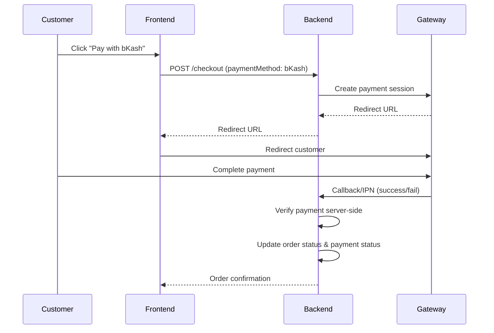

# SharkMart — Backend & Admin Panel Agent Instructions

> **Purpose**: This is the single source of truth for any AI agent working on the **backend API server** and **admin panel** of SharkMart. Read this file completely before writing any code. If you are resuming work, also read `HANDOFF.md` and `STATUS.md` in the project root.

---

## Table of Contents

1. [Project Identity](#project-identity)
2. [Admin Panel Design Mandate](#admin-panel-design-mandate)
3. [Technology Stack](#technology-stack)
4. [Admin Panel Technology](#admin-panel-technology)
5. [Database Schema Design (Prisma)](#database-schema-design-prisma)
6. [API Design — RESTful Endpoints](#api-design--restful-endpoints)
7. [Admin Panel Pages (18 Modules)](#admin-panel-pages-18-modules)
8. [Security Implementation Checklist](#security-implementation-checklist)
9. [Courier API Integration (Bangladesh)](#courier-api-integration-bangladesh)
10. [Payment Gateway Integration (Bangladesh)](#payment-gateway-integration-bangladesh)
11. [Cost Optimization Rules](#cost-optimization-rules-for-agents)
12. [File Structure](#file-structure)
13. [Critical Handoff Rules for Multi-Agent Workflow](#critical-handoff-rules-for-multi-agent-workflow)
14. [Agent Working Style](#agent-working-style)

---

## Project Identity

| Field          | Value                                         |
| -------------- | --------------------------------------------- |
| **Project**    | SharkMart — Multi-Category E-Commerce Platform |
| **Domain**     | `sharkmart.com.bd` (working assumption — confirm with owner) |
| **Target Market** | Bangladesh                                 |
| **Languages**  | Bangla + English (backend serves both)        |
| **Currency**   | BDT (৳) — no multi-currency needed            |

---

## Admin Panel Design Mandate

The Admin Panel **must** use the **same design language** as the customer-facing frontend. It should look like it belongs to the same brand — **NOT** a generic Bootstrap/Tailwind admin template.

### Color Palette

> [!WARNING]
> **The admin panel has its own token set. It is NOT the storefront palette.** The admin brand red is `#c8143c` (not `#C51F4B`), the admin ink is `#16223d` (not `#253858`), and the admin page background is `#f6f7fa` (not `#fbf8f9`). These values are extracted from `admin panel.html` `:root` (lines 21–30). Keep the two sets in separate Tailwind namespaces (`admin.*` vs `brand.*`/`ink.*`) and never let one leak into the other.

| Token        | Hex       | Usage                              |
| ------------ | --------- | ---------------------------------- |
| Brand        | `#c8143c` | Primary actions, active nav, focus |
| Brand 600    | `#a80f31` | Hover / pressed                    |
| Brand 50     | `#fdf0f3` | Active nav background, tints       |
| Brand 100    | `#f9d9e1` | Focus rings, subtle borders        |
| Navy         | `#16223d` | Sidebar, toast, primary text       |
| Navy 2 / 3   | `#24365f` / `#3d5486` | Gradients, meters      |
| Page         | `#f6f7fa` | Page background                    |
| Card         | `#FFFFFF` | Cards, modals, sidebar             |
| Line         | `#e8eaf0` | Dividers, card borders             |
| Line 2       | `#f0f1f5` | Subtle row separators              |
| Text         | `#1a2238` | Body text                          |
| Muted        | `#6b7490` | Secondary text                     |
| Faint        | `#9aa2b8` | Placeholders, chart axis labels    |
| Success      | `#12805c` | Success states, in-stock badges    |
| Warning      | `#a15c00` | Low stock, pending                 |
| Danger       | `#c8143c` | Failed, cancelled, destructive     |
| Info         | `#2b5fd9` | Shipped, in-progress               |

Each semantic color also has a matching `*-bg` tint (`--ok-bg`, `--warn-bg`, `--bad-bg`, `--info-bg`, `--mute-bg`) used for badge and chip backgrounds.

**Dark mode**: `[data-theme=dark]` overrides the same tokens (see `admin panel.html` line 257). Components must consume tokens only — no component should need a dark-mode-specific rule.

### Typography

- **Primary font**: Plus Jakarta Sans (headings, labels, buttons)
- **Bangla font**: Hind Siliguri (Bangla text, mixed content)

### Design Tokens

- **Border radius ramp**: `20px` cards/modals, `14px` medium surfaces, `10px` inputs and rows, `999px` buttons and badges
- **Shadow**: `0 1px 2px rgba(22,34,61,.04), 0 8px 24px -12px rgba(22,34,61,.10)`
- **Spacing**: 8px grid. 18px gap between cards, 22px card padding, 32px page padding on desktop / 18px on mobile
- **Type ramp**: page title 26px/800, card title 16px/700, body 14px, metric 30px/800
- **Sidebar width**: `264px` (`--side`), collapses to an off-canvas drawer at `960px`
- **Breakpoints**: `1180` (grid 4→2), `960` (sidebar collapses), `720` (tables stack, bottom nav appears), `360`
- **Transitions**: 150–200ms ease for hover/focus; all animations disabled under `prefers-reduced-motion`

---

## Technology Stack

| Layer             | Technology                                                        |
| ----------------- | ----------------------------------------------------------------- |
| **Runtime**       | Node.js (LTS)                                                    |
| **Framework**     | Express.js or Fastify (choose based on ecosystem needs)           |
| **Database**      | MySQL 8 (primary) with **Prisma ORM**                             |
| **Cache**         | Redis (sessions, rate limiting, flash sale timers)                |
| **Auth**          | JWT (access + refresh tokens) with HttpOnly cookies               |
| **File Storage**  | Local + configurable S3-compatible (for product images)           |
| **Email**         | Nodemailer with SMTP or transactional service                     |
| **SMS**           | Bangladesh SMS gateway API (configurable)                         |
| **Task Queue**    | BullMQ with Redis (bulk operations, email, SMS)                   |
| **API Style**     | REST API with versioning (`/api/v1/`)                             |
| **Validation**    | Zod schemas                                                       |
| **Logging**       | Pino or Winston (structured JSON logs)                            |
| **Testing**       | Vitest + Supertest                                                |

---

## Admin Panel Technology

- Built as part of the **Next.js frontend app**, under the `/admin` route group
- **Server Components** for data display, **Client Components** for forms/interactions
- Protected by **middleware** — redirect to login if not authenticated
- **Role-based UI**: show/hide features based on staff permissions
- Uses the same component library and design tokens as the storefront

---

## Database Schema Design (Prisma)

> [!IMPORTANT]
> All tables use bilingual fields (`nameEn` / `nameBn`) to support both English and Bangla. Never add a single-language field for user-facing content.

### Core Tables

```prisma
// ─── USER & AUTH ───────────────────────────────────────────────

model User {
  id             String    @id @default(uuid())
  email          String?   @unique
  phone          String?   @unique
  passwordHash   String
  name           String
  role           Role      @default(CUSTOMER)
  isActive       Boolean   @default(true)
  emailVerified  Boolean   @default(false)
  phoneVerified  Boolean   @default(false)
  language       String    @default("bn") // "bn" or "en"
  createdAt      DateTime  @default(now())
  updatedAt      DateTime  @updatedAt

  addresses      Address[]
  orders         Order[]
  reviews        Review[]
  wishlist       Wishlist[]
  cartItems      CartItem[]
  notifications  Notification[]
  auditLogs      AuditLog[]
}

enum Role {
  SUPER_ADMIN
  ADMIN
  ORDER_MANAGER
  INVENTORY_STAFF
  MARKETING_STAFF
  CUSTOMER
}

// ─── ADDRESS ───────────────────────────────────────────────────

model Address {
  id             String    @id @default(uuid())
  userId         String
  label          String?   // "Home", "Office", etc.
  recipientName  String
  phone          String
  division       String
  district       String
  area           String
  address        String
  postalCode     String?
  isDefault      Boolean   @default(false)
  createdAt      DateTime  @default(now())

  user           User      @relation(fields: [userId], references: [id])
}

// ─── CATEGORY ──────────────────────────────────────────────────

model Category {
  id             String     @id @default(uuid())
  slug           String     @unique
  nameEn         String
  nameBn         String
  parentId       String?
  iconEmoji      String?
  bannerImage    String?
  accentColor    String?
  lightTintColor String?
  sortOrder      Int        @default(0)
  isActive       Boolean    @default(true)
  metaTitleEn    String?
  metaTitleBn    String?
  metaDescEn     String?
  metaDescBn     String?
  createdAt      DateTime   @default(now())
  updatedAt      DateTime   @updatedAt

  parent         Category?  @relation("CategoryTree", fields: [parentId], references: [id])
  children       Category[] @relation("CategoryTree")
  products       Product[]
  attributes     ProductAttribute[]
}

// ─── BRAND ─────────────────────────────────────────────────────

model Brand {
  id             String    @id @default(uuid())
  slug           String    @unique
  nameEn         String
  nameBn         String
  logo           String?
  taglineEn      String?
  taglineBn      String?
  color          String?
  isOwnBrand     Boolean   @default(false)
  isActive       Boolean   @default(true)
  sortOrder      Int       @default(0)
  createdAt      DateTime  @default(now())
  updatedAt      DateTime  @updatedAt

  products       Product[]
}

// ─── PRODUCT ───────────────────────────────────────────────────

model Product {
  id              String    @id @default(uuid())
  slug            String    @unique
  sku             String    @unique
  barcode         String?   @unique
  nameEn          String
  nameBn          String
  descriptionEn   String?   @db.Text
  descriptionBn   String?   @db.Text
  categoryId      String
  brandId         String?
  basePrice       Decimal   @db.Decimal(10, 2)
  discountPercent Int       @default(0)
  discountPrice   Decimal?  @db.Decimal(10, 2)
  isPublished     Boolean   @default(false)
  isDraft         Boolean   @default(true)
  isFeatured      Boolean   @default(false)
  isFlashSale     Boolean   @default(false)
  flashSalePrice  Decimal?  @db.Decimal(10, 2)
  flashSaleStart  DateTime?
  flashSaleEnd    DateTime?
  flashSaleStock  Int?
  flashSaleSold   Int       @default(0)
  metaTitleEn     String?
  metaTitleBn     String?
  metaDescEn      String?
  metaDescBn      String?
  createdAt       DateTime  @default(now())
  updatedAt       DateTime  @updatedAt

  category        Category  @relation(fields: [categoryId], references: [id])
  brand           Brand?    @relation(fields: [brandId], references: [id])
  images          ProductImage[]
  videos          ProductVideo[]
  variants        ProductVariant[]
  details         ProductDetail[]
  specifications  ProductSpecification[]
  reviews         Review[]
  orderItems      OrderItem[]
  wishlist        Wishlist[]
  cartItems       CartItem[]
}

model ProductImage {
  id         String  @id @default(uuid())
  productId  String
  url        String
  altEn      String?
  altBn      String?
  sortOrder  Int     @default(0)
  isMain     Boolean @default(false)

  product    Product @relation(fields: [productId], references: [id], onDelete: Cascade)
}

model ProductVideo {
  id           String       @id @default(uuid())
  productId    String
  type         VideoType
  url          String
  thumbnailUrl String?
  sortOrder    Int          @default(0)

  product      Product      @relation(fields: [productId], references: [id], onDelete: Cascade)
}

enum VideoType {
  YOUTUBE
  FACEBOOK
  UPLOAD
}

model ProductVariant {
  id            String          @id @default(uuid())
  productId     String
  sku           String          @unique
  barcode       String?         @unique
  nameEn        String
  nameBn        String
  price         Decimal         @db.Decimal(10, 2)
  stock         Int             @default(0)
  reservedStock Int             @default(0)
  sortOrder     Int             @default(0)
  isActive      Boolean         @default(true)

  product       Product         @relation(fields: [productId], references: [id], onDelete: Cascade)
  options       VariantOption[]
  orderItems    OrderItem[]
  cartItems     CartItem[]
}

model VariantOption {
  id          String          @id @default(uuid())
  variantId   String
  attributeId String
  valueEn     String
  valueBn     String

  variant     ProductVariant  @relation(fields: [variantId], references: [id], onDelete: Cascade)
  attribute   ProductAttribute @relation(fields: [attributeId], references: [id])
}

model ProductAttribute {
  id         String          @id @default(uuid())
  categoryId String?
  nameEn     String
  nameBn     String
  type       AttributeType
  sortOrder  Int             @default(0)

  category   Category?       @relation(fields: [categoryId], references: [id])
  options    VariantOption[]
}

enum AttributeType {
  SIZE
  COLOR
  WEIGHT
  CAPACITY
  MODEL
  PACK_SIZE
  CUSTOM
}

model ProductDetail {
  id         String        @id @default(uuid())
  productId  String
  section    DetailSection
  contentEn  String?       @db.Text
  contentBn  String?       @db.Text
  sortOrder  Int           @default(0)

  product    Product       @relation(fields: [productId], references: [id], onDelete: Cascade)
}

enum DetailSection {
  OVERVIEW
  DESCRIPTION
  FEATURES
  SPECS
  HOW_TO_USE
  INGREDIENTS
  SIZE_GUIDE
  PACKAGE_CONTENTS
  CARE
  WARRANTY
  DELIVERY_RETURN
  FAQ
}

model ProductSpecification {
  id        String  @id @default(uuid())
  productId String
  labelEn   String
  labelBn   String
  valueEn   String
  valueBn   String
  sortOrder Int     @default(0)

  product   Product @relation(fields: [productId], references: [id], onDelete: Cascade)
}

// ─── REVIEW ────────────────────────────────────────────────────

model Review {
  id                 String        @id @default(uuid())
  productId          String
  userId             String
  rating             Int           // 1-5
  titleEn            String?
  titleBn            String?
  contentEn          String?       @db.Text
  contentBn          String?       @db.Text
  isVerifiedPurchase Boolean       @default(false)
  isApproved         Boolean       @default(false)
  isFlagged          Boolean       @default(false)
  helpfulCount       Int           @default(0)
  createdAt          DateTime      @default(now())

  product            Product       @relation(fields: [productId], references: [id])
  user               User          @relation(fields: [userId], references: [id])
  media              ReviewMedia[]
}

model ReviewMedia {
  id       String    @id @default(uuid())
  reviewId String
  type     MediaType
  url      String

  review   Review    @relation(fields: [reviewId], references: [id], onDelete: Cascade)
}

enum MediaType {
  IMAGE
  VIDEO
}

// ─── ORDER ─────────────────────────────────────────────────────

model Order {
  id               String             @id @default(uuid())
  orderNumber      String             @unique
  userId           String?
  guestPhone       String?
  guestName        String?
  currentStatus    OrderStatus        @default(PENDING)
  subtotal         Decimal            @db.Decimal(10, 2)
  discountAmount   Decimal            @default(0) @db.Decimal(10, 2)
  couponId         String?
  deliveryCharge   Decimal            @db.Decimal(10, 2)
  totalAmount      Decimal            @db.Decimal(10, 2)
  paymentMethod    String             // COD, bKash, Nagad, SSLCommerz
  paymentStatus    PaymentStatus      @default(UNPAID)
  paidAmount       Decimal            @default(0) @db.Decimal(10, 2)
  courierName      String?
  consignmentId    String?
  trackingUrl      String?
  notes            String?            @db.Text
  createdAt        DateTime           @default(now())
  updatedAt        DateTime           @updatedAt

  user             User?              @relation(fields: [userId], references: [id])
  coupon           Coupon?            @relation(fields: [couponId], references: [id])
  items            OrderItem[]
  statusHistory    OrderStatusHistory[]
  shippingAddress  ShippingAddress?
}

enum OrderStatus {
  PENDING
  CONFIRMED
  PROCESSING
  SHIPPED
  DELIVERED
  CANCELLED
  RETURNED
  REFUND_PENDING
  REFUNDED
}

enum PaymentStatus {
  UNPAID
  PARTIALLY_PAID
  PAID
  REFUNDED
}

model OrderItem {
  id              String          @id @default(uuid())
  orderId         String
  productId       String
  variantId       String?
  nameEn          String          // Snapshot at order time
  nameBn          String          // Snapshot at order time
  sku             String
  quantity        Int
  unitPrice       Decimal         @db.Decimal(10, 2)
  discountPercent Int             @default(0)
  lineTotal       Decimal         @db.Decimal(10, 2)
  returnStatus    ReturnStatus?

  order           Order           @relation(fields: [orderId], references: [id])
  product         Product         @relation(fields: [productId], references: [id])
  variant         ProductVariant? @relation(fields: [variantId], references: [id])
}

enum ReturnStatus {
  REQUESTED
  APPROVED
  REJECTED
  RECEIVED
  REFUNDED
}

model OrderStatusHistory {
  id        String      @id @default(uuid())
  orderId   String
  status    OrderStatus
  note      String?
  changedBy String?     // userId of admin/staff
  createdAt DateTime    @default(now())

  order     Order       @relation(fields: [orderId], references: [id])
}

model ShippingAddress {
  id            String  @id @default(uuid())
  orderId       String  @unique
  recipientName String
  phone         String
  division      String
  district      String
  area          String
  address       String
  postalCode    String?

  order         Order   @relation(fields: [orderId], references: [id])
}

// ─── COUPON ────────────────────────────────────────────────────

model Coupon {
  id                    String      @id @default(uuid())
  code                  String      @unique
  type                  CouponType
  value                 Decimal     @db.Decimal(10, 2)
  minOrderValue         Decimal?    @db.Decimal(10, 2)
  maxDiscount           Decimal?    @db.Decimal(10, 2)
  usageLimit            Int?
  usedCount             Int         @default(0)
  perUserLimit          Int         @default(1)
  startDate             DateTime
  endDate               DateTime
  applicableCategories  Json?       // String[] of category IDs
  applicableBrands      Json?       // String[] of brand IDs
  applicableProducts    Json?       // String[] of product IDs
  isActive              Boolean     @default(true)
  createdAt             DateTime    @default(now())

  orders                Order[]
}

enum CouponType {
  FIXED
  PERCENTAGE
  FREE_DELIVERY
}

// ─── WISHLIST & CART ───────────────────────────────────────────

model Wishlist {
  id        String   @id @default(uuid())
  userId    String
  productId String
  createdAt DateTime @default(now())

  user      User     @relation(fields: [userId], references: [id])
  product   Product  @relation(fields: [productId], references: [id])

  @@unique([userId, productId])
}

model CartItem {
  id        String          @id @default(uuid())
  userId    String?
  visitorId String?
  productId String
  variantId String?
  quantity  Int             @default(1)
  createdAt DateTime        @default(now())

  user      User?           @relation(fields: [userId], references: [id])
  product   Product         @relation(fields: [productId], references: [id])
  variant   ProductVariant? @relation(fields: [variantId], references: [id])
}

// ─── NOTIFICATION ──────────────────────────────────────────────

model Notification {
  id          String             @id @default(uuid())
  type        String
  recipientId String
  channel     NotificationChannel
  subject     String?
  body        String             @db.Text
  status      String             @default("PENDING") // PENDING, SENT, FAILED
  sentAt      DateTime?
  createdAt   DateTime           @default(now())

  recipient   User               @relation(fields: [recipientId], references: [id])
}

enum NotificationChannel {
  SMS
  EMAIL
  PUSH
}

// ─── AUDIT & SETTINGS ─────────────────────────────────────────

model AuditLog {
  id        String   @id @default(uuid())
  userId    String?
  action    String
  entity    String
  entityId  String
  changes   Json?
  ipAddress String?
  createdAt DateTime @default(now())

  user      User?    @relation(fields: [userId], references: [id])
}

model Setting {
  id    String @id @default(uuid())
  key   String @unique
  value String @db.Text
  group String @default("general")
}
```

### Business Management Tables

```prisma
// ─── SUPPLIER & PURCHASING ─────────────────────────────────────

model Supplier {
  id             String            @id @default(uuid())
  name           String
  contactPerson  String?
  phone          String
  email          String?
  address        String?
  isActive       Boolean           @default(true)
  createdAt      DateTime          @default(now())

  products       SupplierProduct[]
  purchaseOrders PurchaseOrder[]
}

model SupplierProduct {
  id         String   @id @default(uuid())
  supplierId String
  productId  String
  costPrice  Decimal  @db.Decimal(10, 2)
  leadDays   Int?

  supplier   Supplier @relation(fields: [supplierId], references: [id])
  product    Product  @relation(fields: [productId], references: [id])
}

model PurchaseOrder {
  id          String              @id @default(uuid())
  supplierId  String
  status      String              @default("DRAFT") // DRAFT, ORDERED, PARTIAL, RECEIVED, CANCELLED
  totalAmount Decimal             @db.Decimal(10, 2)
  notes       String?             @db.Text
  createdAt   DateTime            @default(now())
  receivedAt  DateTime?

  supplier    Supplier            @relation(fields: [supplierId], references: [id])
  items       PurchaseOrderItem[]
}

model PurchaseOrderItem {
  id              String        @id @default(uuid())
  purchaseOrderId String
  productId       String
  variantId       String?
  quantity        Int
  receivedQuantity Int          @default(0)
  costPrice       Decimal       @db.Decimal(10, 2)

  purchaseOrder   PurchaseOrder @relation(fields: [purchaseOrderId], references: [id])
}

// ─── WAREHOUSE & STOCK ─────────────────────────────────────────

model Warehouse {
  id        String           @id @default(uuid())
  name      String
  address   String?
  isDefault Boolean          @default(false)
  isActive  Boolean          @default(true)

  stock     WarehouseStock[]
}

model WarehouseStock {
  id          String    @id @default(uuid())
  warehouseId String
  productId   String
  variantId   String?
  quantity    Int       @default(0)
  binLocation String?

  warehouse   Warehouse @relation(fields: [warehouseId], references: [id])
}

model StockTransfer {
  id              String   @id @default(uuid())
  fromWarehouseId String
  toWarehouseId   String
  productId       String
  variantId       String?
  quantity        Int
  status          String   @default("PENDING") // PENDING, IN_TRANSIT, COMPLETED, CANCELLED
  createdAt       DateTime @default(now())
}

model StockMovement {
  id            String       @id @default(uuid())
  productId     String
  variantId     String?
  warehouseId   String?
  type          MovementType
  quantity      Int
  reason        String?
  referenceType String?      // ORDER, PURCHASE_ORDER, TRANSFER, ADJUSTMENT
  referenceId   String?
  createdBy     String?
  createdAt     DateTime     @default(now())
}

enum MovementType {
  IN
  OUT
  ADJUSTMENT
  TRANSFER
  RETURN
}

// ─── EXPENSE ───────────────────────────────────────────────────

model Expense {
  id          String   @id @default(uuid())
  category    String
  description String
  amount      Decimal  @db.Decimal(10, 2)
  date        DateTime
  receiptUrl  String?
  createdBy   String
  createdAt   DateTime @default(now())
}

// ─── EMPLOYEE & HR ─────────────────────────────────────────────

model Employee {
  id          String         @id @default(uuid())
  userId      String         @unique
  department  String?
  designation String?
  joiningDate DateTime?
  salary      Decimal?       @db.Decimal(10, 2)
  isActive    Boolean        @default(true)

  attendance  Attendance[]
  leaves      LeaveRequest[]
}

model Attendance {
  id         String    @id @default(uuid())
  employeeId String
  date       DateTime
  checkIn    DateTime?
  checkOut   DateTime?
  status     String    @default("PRESENT") // PRESENT, ABSENT, LATE, HALF_DAY

  employee   Employee  @relation(fields: [employeeId], references: [id])
}

model LeaveRequest {
  id         String   @id @default(uuid())
  employeeId String
  type       String   // CASUAL, SICK, ANNUAL, UNPAID
  startDate  DateTime
  endDate    DateTime
  reason     String?
  status     String   @default("PENDING") // PENDING, APPROVED, REJECTED
  approvedBy String?

  employee   Employee @relation(fields: [employeeId], references: [id])
}

// ─── LANDING PAGE ──────────────────────────────────────────────

model LandingPage {
  id           String             @id @default(uuid())
  slug         String             @unique
  title        String
  productId    String?
  campaignName String?
  isActive     Boolean            @default(true)
  content      Json?              // Flexible page content structure
  createdAt    DateTime           @default(now())

  orders       LandingPageOrder[]
}

model LandingPageOrder {
  id            String      @id @default(uuid())
  landingPageId String
  name          String
  phone         String
  address       String
  productId     String
  variantId     String?
  quantity      Int         @default(1)
  status        String      @default("PENDING")
  createdAt     DateTime    @default(now())

  landingPage   LandingPage @relation(fields: [landingPageId], references: [id])
}

// ─── TEMPLATES ─────────────────────────────────────────────────

model SMSTemplate {
  id         String @id @default(uuid())
  name       String
  templateEn String @db.Text
  templateBn String @db.Text
  type       String // TRANSACTIONAL, PROMOTIONAL
}

model EmailTemplate {
  id        String @id @default(uuid())
  name      String
  subjectEn String
  subjectBn String
  bodyEn    String @db.Text
  bodyBn    String @db.Text
  type      String // TRANSACTIONAL, PROMOTIONAL
}
```

> [!NOTE]
> The `Product` model must also add a relation field for `SupplierProduct[]` when the business management tables are implemented. Keep models loosely coupled initially and add relation fields as features are built.

---

## API Design — RESTful Endpoints

> [!IMPORTANT]
> All endpoints return consistent JSON responses:
> ```json
> // Success
> { "success": true, "data": { ... }, "meta": { "page": 1, "limit": 20, "total": 100 } }
>
> // Error
> { "success": false, "error": { "code": "VALIDATION_ERROR", "message": "...", "details": [...] } }
> ```

### Public API (no auth required)

| Method | Endpoint                        | Description                |
| ------ | ------------------------------- | -------------------------- |
| GET    | `/api/v1/products`              | List with filters, sort, pagination |
| GET    | `/api/v1/products/:slug`        | Product detail             |
| GET    | `/api/v1/categories`            | Category tree              |
| GET    | `/api/v1/categories/:slug`      | Category with products     |
| GET    | `/api/v1/brands`                | All brands                 |
| GET    | `/api/v1/brands/:slug`          | Brand landing              |
| GET    | `/api/v1/search?q=`             | Search products            |
| GET    | `/api/v1/flash-sale`            | Active flash sale          |
| GET    | `/api/v1/homepage`              | Homepage sections data     |
| GET    | `/api/v1/landing/:slug`         | Landing page               |
| POST   | `/api/v1/landing/:slug/order`   | Landing page order         |

### Customer API (auth required)

#### Authentication

| Method | Endpoint                         | Description            |
| ------ | -------------------------------- | ---------------------- |
| POST   | `/api/v1/auth/register`          | Register new customer  |
| POST   | `/api/v1/auth/login`             | Login                  |
| POST   | `/api/v1/auth/refresh`           | Refresh JWT token      |
| POST   | `/api/v1/auth/logout`            | Logout (invalidate refresh token) |
| POST   | `/api/v1/auth/forgot-password`   | Send reset link/OTP    |
| POST   | `/api/v1/auth/reset-password`    | Reset with token/OTP   |

#### Profile & Addresses

| Method | Endpoint                         | Description            |
| ------ | -------------------------------- | ---------------------- |
| GET    | `/api/v1/me`                     | Get profile            |
| PUT    | `/api/v1/me`                     | Update profile         |
| GET    | `/api/v1/me/addresses`           | List addresses         |
| POST   | `/api/v1/me/addresses`           | Add address            |
| PUT    | `/api/v1/me/addresses/:id`       | Update address         |
| DELETE | `/api/v1/me/addresses/:id`       | Delete address         |

#### Orders

| Method | Endpoint                         | Description            |
| ------ | -------------------------------- | ---------------------- |
| GET    | `/api/v1/me/orders`              | List my orders         |
| GET    | `/api/v1/me/orders/:id`          | Order detail           |
| POST   | `/api/v1/me/orders/:id/cancel`   | Request cancellation   |
| POST   | `/api/v1/me/orders/:id/return`   | Request return         |

#### Wishlist

| Method | Endpoint                         | Description            |
| ------ | -------------------------------- | ---------------------- |
| GET    | `/api/v1/me/wishlist`            | List wishlist          |
| POST   | `/api/v1/me/wishlist`            | Add to wishlist        |
| DELETE | `/api/v1/me/wishlist/:productId` | Remove from wishlist   |

#### Cart

| Method | Endpoint                         | Description            |
| ------ | -------------------------------- | ---------------------- |
| POST   | `/api/v1/cart/sync`              | Sync local cart on login |
| GET    | `/api/v1/cart`                   | Get cart               |
| POST   | `/api/v1/cart/items`             | Add to cart            |
| PUT    | `/api/v1/cart/items/:id`         | Update quantity        |
| DELETE | `/api/v1/cart/items/:id`         | Remove from cart       |

#### Checkout & Tracking

| Method | Endpoint                         | Description            |
| ------ | -------------------------------- | ---------------------- |
| POST   | `/api/v1/checkout`               | Place order            |
| POST   | `/api/v1/checkout/verify-payment`| Verify gateway callback |
| GET    | `/api/v1/track/:orderNumber`     | Public tracking (phone verification) |

#### Reviews

| Method | Endpoint                         | Description            |
| ------ | -------------------------------- | ---------------------- |
| POST   | `/api/v1/reviews`                | Submit review          |
| PUT    | `/api/v1/reviews/:id`            | Edit review            |
| DELETE | `/api/v1/reviews/:id`            | Delete review          |
| POST   | `/api/v1/reviews/:id/helpful`    | Mark as helpful        |
| POST   | `/api/v1/reviews/:id/report`     | Report review          |

### Admin API (role-based auth)

> [!WARNING]
> Every admin endpoint **must** check both authentication AND role-based authorization. Use the RBAC middleware on all admin routes.

#### Dashboard & Reports

| Method | Endpoint                              | Description                              |
| ------ | ------------------------------------- | ---------------------------------------- |
| GET    | `/api/v1/admin/dashboard`             | Sales overview, order counts, stock alerts |
| GET    | `/api/v1/admin/reports/:type`         | sales, orders, products, inventory, profit |

#### Products

| Method | Endpoint                              | Description                |
| ------ | ------------------------------------- | -------------------------- |
| GET    | `/api/v1/admin/products`              | List with advanced filters |
| POST   | `/api/v1/admin/products`              | Create product             |
| PUT    | `/api/v1/admin/products/:id`          | Update product             |
| DELETE | `/api/v1/admin/products/:id`          | Delete product (soft)      |
| POST   | `/api/v1/admin/products/bulk`         | Bulk operations            |
| POST   | `/api/v1/admin/products/import`       | CSV/Excel import           |
| GET    | `/api/v1/admin/products/export`       | CSV/Excel export           |

#### Variants

| Method | Endpoint                              | Description                |
| ------ | ------------------------------------- | -------------------------- |
| POST   | `/api/v1/admin/products/:id/variants` | Add variant                |
| PUT    | `/api/v1/admin/variants/:id`          | Update variant             |
| DELETE | `/api/v1/admin/variants/:id`          | Delete variant             |

#### Categories

| Method | Endpoint                              | Description                |
| ------ | ------------------------------------- | -------------------------- |
| GET    | `/api/v1/admin/categories`            | List all categories        |
| POST   | `/api/v1/admin/categories`            | Create category            |
| PUT    | `/api/v1/admin/categories/:id`        | Update category            |
| DELETE | `/api/v1/admin/categories/:id`        | Delete category            |
| PUT    | `/api/v1/admin/categories/reorder`    | Reorder categories         |

#### Brands

| Method | Endpoint                              | Description                |
| ------ | ------------------------------------- | -------------------------- |
| GET    | `/api/v1/admin/brands`                | List all brands            |
| POST   | `/api/v1/admin/brands`                | Create brand               |
| PUT    | `/api/v1/admin/brands/:id`            | Update brand               |
| DELETE | `/api/v1/admin/brands/:id`            | Delete brand               |

#### Orders

| Method | Endpoint                                  | Description                |
| ------ | ----------------------------------------- | -------------------------- |
| GET    | `/api/v1/admin/orders`                    | List with filters          |
| GET    | `/api/v1/admin/orders/:id`                | Order detail               |
| PUT    | `/api/v1/admin/orders/:id/status`         | Update status              |
| POST   | `/api/v1/admin/orders/bulk-status`        | Bulk status update         |
| POST   | `/api/v1/admin/orders/manual`             | Manual order entry         |
| GET    | `/api/v1/admin/orders/:id/invoice`        | Generate invoice           |
| POST   | `/api/v1/admin/orders/:id/courier-book`   | Book courier               |

#### Inventory

| Method | Endpoint                              | Description                |
| ------ | ------------------------------------- | -------------------------- |
| GET    | `/api/v1/admin/inventory`             | Stock overview             |
| POST   | `/api/v1/admin/inventory/adjust`      | Adjust stock               |
| GET    | `/api/v1/admin/inventory/movements`   | Movement history           |
| GET    | `/api/v1/admin/inventory/alerts`      | Low/out-of-stock alerts    |

#### Warehouse

| Method | Endpoint                              | Description                |
| ------ | ------------------------------------- | -------------------------- |
| GET    | `/api/v1/admin/warehouses`            | List warehouses            |
| POST   | `/api/v1/admin/warehouses`            | Create warehouse           |
| POST   | `/api/v1/admin/warehouses/transfer`   | Transfer stock             |
| GET    | `/api/v1/admin/warehouses/:id/stock`  | Warehouse stock details    |

#### Suppliers & Purchase Orders

| Method | Endpoint                                       | Description                |
| ------ | ---------------------------------------------- | -------------------------- |
| GET    | `/api/v1/admin/suppliers`                      | List suppliers             |
| POST   | `/api/v1/admin/suppliers`                      | Create supplier            |
| PUT    | `/api/v1/admin/suppliers/:id`                  | Update supplier            |
| DELETE | `/api/v1/admin/suppliers/:id`                  | Delete supplier            |
| POST   | `/api/v1/admin/purchase-orders`                | Create purchase order      |
| GET    | `/api/v1/admin/purchase-orders`                | List purchase orders       |
| PUT    | `/api/v1/admin/purchase-orders/:id/receive`    | Mark as received           |

#### Coupons & Offers

| Method | Endpoint                              | Description                |
| ------ | ------------------------------------- | -------------------------- |
| GET    | `/api/v1/admin/coupons`               | List coupons               |
| POST   | `/api/v1/admin/coupons`               | Create coupon              |
| PUT    | `/api/v1/admin/coupons/:id`           | Update coupon              |
| DELETE | `/api/v1/admin/coupons/:id`           | Delete coupon              |
| POST   | `/api/v1/admin/flash-sales`           | Schedule flash sale        |

#### Homepage Management

| Method | Endpoint                              | Description                |
| ------ | ------------------------------------- | -------------------------- |
| GET    | `/api/v1/admin/homepage/sections`     | Get homepage sections      |
| PUT    | `/api/v1/admin/homepage/sections`     | Update homepage sections   |
| POST   | `/api/v1/admin/homepage/banners`      | Upload/manage banners      |

#### Reviews Moderation

| Method | Endpoint                              | Description                |
| ------ | ------------------------------------- | -------------------------- |
| GET    | `/api/v1/admin/reviews`               | List reviews (pending/all) |
| PUT    | `/api/v1/admin/reviews/:id/moderate`  | Approve/reject/flag        |

#### CRM (Customer Management)

| Method | Endpoint                              | Description                |
| ------ | ------------------------------------- | -------------------------- |
| GET    | `/api/v1/admin/customers`             | List customers             |
| GET    | `/api/v1/admin/customers/:id`         | Customer detail            |
| POST   | `/api/v1/admin/customers/:id/notes`   | Add customer note          |
| GET    | `/api/v1/admin/customers/segments`    | Customer segments          |

#### HRM (Staff Management)

| Method | Endpoint                              | Description                |
| ------ | ------------------------------------- | -------------------------- |
| GET    | `/api/v1/admin/staff`                 | List staff                 |
| POST   | `/api/v1/admin/staff`                 | Add staff                  |
| PUT    | `/api/v1/admin/staff/:id`             | Update staff               |
| DELETE | `/api/v1/admin/staff/:id`             | Remove staff               |
| GET    | `/api/v1/admin/staff/:id/attendance`  | Attendance records         |
| POST   | `/api/v1/admin/staff/:id/leave`       | Submit leave request       |

#### Marketing (SMS & Email)

| Method | Endpoint                              | Description                |
| ------ | ------------------------------------- | -------------------------- |
| POST   | `/api/v1/admin/sms/send`              | Send single SMS            |
| POST   | `/api/v1/admin/sms/bulk`              | Bulk SMS campaign          |
| GET    | `/api/v1/admin/sms/templates`         | List SMS templates         |
| POST   | `/api/v1/admin/sms/templates`         | Create SMS template        |
| PUT    | `/api/v1/admin/sms/templates/:id`     | Update SMS template        |
| DELETE | `/api/v1/admin/sms/templates/:id`     | Delete SMS template        |
| POST   | `/api/v1/admin/email/send`            | Send single email          |
| POST   | `/api/v1/admin/email/bulk`            | Bulk email campaign        |
| GET    | `/api/v1/admin/email/templates`       | List email templates       |
| POST   | `/api/v1/admin/email/templates`       | Create email template      |
| PUT    | `/api/v1/admin/email/templates/:id`   | Update email template      |
| DELETE | `/api/v1/admin/email/templates/:id`   | Delete email template      |

#### Landing Pages

| Method | Endpoint                                   | Description                |
| ------ | ------------------------------------------ | -------------------------- |
| GET    | `/api/v1/admin/landing-pages`              | List landing pages         |
| POST   | `/api/v1/admin/landing-pages`              | Create landing page        |
| PUT    | `/api/v1/admin/landing-pages/:id`          | Update landing page        |
| DELETE | `/api/v1/admin/landing-pages/:id`          | Delete landing page        |
| GET    | `/api/v1/admin/landing-pages/:id/orders`   | Landing page orders        |

#### Barcode

| Method | Endpoint                              | Description                |
| ------ | ------------------------------------- | -------------------------- |
| POST   | `/api/v1/admin/barcode/generate`      | Generate barcode           |
| POST   | `/api/v1/admin/barcode/print`         | Print barcode labels       |

#### POS (Point of Sale)

| Method | Endpoint                              | Description                |
| ------ | ------------------------------------- | -------------------------- |
| POST   | `/api/v1/admin/pos/sale`              | Record POS sale            |
| GET    | `/api/v1/admin/pos/lookup?barcode=`   | Lookup by barcode          |
| POST   | `/api/v1/admin/pos/receipt`           | Generate receipt           |

#### Settings & System

| Method | Endpoint                              | Description                |
| ------ | ------------------------------------- | -------------------------- |
| GET    | `/api/v1/admin/settings`              | Get all settings           |
| PUT    | `/api/v1/admin/settings`              | Update settings            |
| GET    | `/api/v1/admin/audit-log`             | Audit log viewer           |
| POST   | `/api/v1/admin/backup`                | Trigger database backup    |
| GET    | `/api/v1/admin/system/health`         | System health check        |

#### Expenses & Financial Reports

| Method | Endpoint                              | Description                |
| ------ | ------------------------------------- | -------------------------- |
| GET    | `/api/v1/admin/expenses`              | List expenses              |
| POST   | `/api/v1/admin/expenses`              | Add expense                |
| PUT    | `/api/v1/admin/expenses/:id`          | Update expense             |
| DELETE | `/api/v1/admin/expenses/:id`          | Delete expense             |
| GET    | `/api/v1/admin/reports/profit`        | Profit & loss report       |
| GET    | `/api/v1/admin/reports/accounts-summary` | Accounts overview       |

#### Courier Integration

| Method | Endpoint                                             | Description                |
| ------ | ---------------------------------------------------- | -------------------------- |
| GET    | `/api/v1/admin/couriers`                             | List configured couriers   |
| POST   | `/api/v1/admin/couriers/:name/book`                  | Book single parcel         |
| GET    | `/api/v1/admin/couriers/:name/track/:consignmentId`  | Track parcel               |
| POST   | `/api/v1/admin/couriers/bulk-book`                   | Bulk book parcels          |

---

## Admin Panel Pages (18 Modules)

### 1. Dashboard

- **Sales overview cards**: Today, This Week, This Month, Total — each showing revenue and order count
- **Revenue & orders charts**: Line/bar charts with date range selector
- **Average order value** trend
- **Order status pipeline**: Visual kanban-style pipeline showing count at each status
- **Low stock alerts**: Products below threshold, with quick-action to restock
- **Recent orders table**: Last 10 orders with status badges
- **Top selling products**: Last 7/30 days
- **Quick actions**: New order, Add product, Send SMS buttons

### 2. Product Management

- **Product list**: Search, filter by category/brand/status/stock level, sort by price/date/sales
- **Add/Edit product form**:
  - Basic info: name (bn/en), auto-generated slug, SKU, barcode
  - Category + subcategory cascading picker
  - Brand picker with search
  - Pricing: base price, discount %, auto-calculated discount price display
  - Image upload: drag-drop, reorder, set main image, alt text bn/en
  - Video URL management (YouTube/Facebook/Upload)
  - **Variant builder**: Select attribute type → add options → set individual price/stock/SKU/image per variant
  - Rich text description sections (WYSIWYG editor)
  - Specifications table builder (label/value pairs)
  - SEO fields (meta title, description bn/en)
  - Status toggles: publish, draft, featured, flash sale (with schedule)
- **Bulk actions**: Edit prices %, update stock, toggle publish, import/export CSV
- **Barcode generator**: Generate & print barcode labels

### 3. Category Management

- **Tree view**: Hierarchical display with drag-to-reorder
- **Add/edit form**: name bn/en, slug, icon emoji, banner image upload, accent color picker, parent category selector, category-specific attributes, SEO fields
- **Landing page content editor** for category pages

### 4. Brand Management

- **Tabbed view**: Own Brands vs. External Brands
- **Add/edit form**: name bn/en, logo upload, tagline, accent color, landing page content
- **Brand performance** quick stats

### 5. Order Management

- **Order list**: Filterable by status, date range, payment method, courier, search by order number/phone
- **Order detail view**: Full timeline history, customer info, items, payment info, courier tracking
- **Status update**: Dropdown with required notes, automatic customer notification
- **Bulk status update**: Select multiple orders → change status
- **Manual order creation**: Full form for phone/walk-in orders
- **Invoice generator**: Thermal (80mm) + A4 format, both bn/en
- **Shipping label generator**: Per courier format
- **Courier booking**: Integrated booking with Steadfast, Pathao, RedX, CarryBee
- **Return/cancellation workflow**: Status tracking, restocking, refund processing

### 6. Inventory Management

- **Stock overview dashboard**: Total items, total value, low stock count, out of stock count
- **Stock adjustment form**: Product/variant selector, quantity adjustment (+/-), mandatory reason field
- **Movement history log**: Filterable table of all stock in/out/adjustments
- **Alert management**: Configurable low stock thresholds, automated notifications
- **Inventory valuation report**: Cost-based valuation with export

### 7. Warehouse Management

- **Warehouse list**: Name, address, stock count per warehouse
- **Stock transfer form**: Source → destination warehouse, product selection, quantity
- **Receiving & dispatch tracking**: Incoming/outgoing transfer log
- **Bin/shelf location assignment**: Per product/variant location within warehouse

### 8. Supplier Management

- **Supplier directory**: Searchable list with contact info and status
- **Purchase order creation**: Select supplier → add products → set quantities/prices → submit
- **Goods receiving form**: Check off received items against PO, note discrepancies
- **Supplier invoice tracking**: Link invoices to POs, track payment status
- **Payment status tracking**: Outstanding balance per supplier
- **Supplier performance metrics**: Lead time, fulfillment rate, defect rate

### 9. Coupon & Offers

- **Coupon builder**: Code, type (fixed/percentage/free delivery), value, min order, max discount, date range, usage limits, per-user limits, applicable categories/brands/products
- **Flash sale scheduler**: Select products, set sale price, start/end time, stock limit
- **Bundle/combo deal creator**: Combine products with bundle pricing
- **Active offers overview**: All running promotions in one view
- **Usage/redemption reports**: Who used which coupon, revenue impact

### 10. CRM (Customer Management)

- **Customer list**: Segmented views (new, returning, high-value, inactive)
- **Customer profile**: Order history, total spent, wishlist, reviews, internal notes
- **Communication history**: SMS/email log for this customer
- **Customer-targeted offers**: Send personalized coupon/offer

### 11. HRM (Staff Management)

- **Employee records**: Personal info, department, designation, joining date
- **Role & permission assignment**: Map user account to role, configure permissions
- **Attendance tracking**: Daily check-in/out, monthly summary
- **Leave management**: Request → approval workflow, balance tracking
- **Basic payroll records**: Salary info, payment history

### 12. Marketing (SMS & Email)

- **SMS campaign sender**: Compose message (bn/en), select recipients, schedule or send now
- **Email campaign sender**: Rich HTML email composer, preview, schedule
- **Template builder**: Reusable templates with variables (bn/en)
- **Recipient segment picker**: By purchase history, location, activity level
- **Delivery reports**: Sent, delivered, failed counts
- **Cost tracking**: SMS cost per campaign

### 13. POS (Point of Sale)

- **Barcode scanner input**: Scan to add products to cart
- **Quick product search**: Name/SKU search with autocomplete
- **Cart**: Line items with quantity adjuster, per-item discount
- **Payment method selection**: Cash, bKash, Nagad, card
- **Receipt printing**: Thermal printer compatible (80mm)
- **Shift reports**: Sales summary per shift/staff

### 14. Landing Pages & Campaigns

- **Landing page builder**: WYSIWYG editor with product showcase, CTA form
- **One-page order form**: Name, phone, address → instant order
- **Campaign performance tracking**: Views, orders, conversion rate per page

### 15. Reports & Analytics

- **Sales reports**: Daily, weekly, monthly, yearly, custom date range
- **Product performance**: Best sellers, worst sellers, trending
- **Category performance**: Revenue per category
- **Brand-wise sales**: Revenue per brand
- **Profit/margin reports**: Revenue vs. cost analysis
- **Export**: CSV and Excel download for all reports

### 16. SEO Management

- **Product/category/page meta editor**: Bulk edit meta titles & descriptions
- **Sitemap management**: Auto-generated, manual additions
- **Robots.txt editor**: UI-based rule editor

### 17. Settings

- **Store info**: Name, address, phone, email, logo, social links
- **Delivery charge configuration**: Division-based, weight-based, free delivery threshold
- **Payment gateway settings**: bKash, Nagad, SSLCommerz credentials & toggles
- **SMS gateway settings**: API credentials, sender ID, balance check
- **Email settings**: SMTP host/port/user/pass, domain email
- **Tracking codes**: GA4 Measurement ID, Meta Pixel ID, GTM Container ID
- **Cloudflare settings**: Zone ID, API token (for cache purge)
- **Backup & restore**: Manual trigger, download, restore from backup

### 18. System & Security

- **Audit log viewer**: Filterable table of all admin actions (who, what, when, IP)
- **Active sessions**: List of logged-in admin/staff sessions, force logout
- **Error log**: Recent server errors with stack traces (dev mode only)
- **System health check**: Database, Redis, disk, queue status
- **Backup management**: Scheduled backups, retention policy, restore

---

## Security Implementation Checklist

> [!CAUTION]
> Every agent working on auth, orders, or payment features **must** verify these items before marking work as complete.

| #  | Area                | Implementation                                                                                                   |
| -- | ------------------- | ---------------------------------------------------------------------------------------------------------------- |
| 1  | **Authentication**  | JWT access token (15 min TTL) + refresh token (7 day TTL) in HttpOnly, Secure, SameSite cookies                  |
| 2  | **Password**        | bcrypt with **12 rounds minimum**. Never store plaintext. Never log passwords.                                   |
| 3  | **RBAC**            | Middleware checks both `role` AND specific permissions per endpoint. Define a permission map.                     |
| 4  | **IDOR Prevention** | Always check resource ownership — user can only access their own orders, reviews, addresses. Never trust client IDs alone. |
| 5  | **Input Validation**| Zod schemas on **every** endpoint — request body, query params, URL params. Reject invalid early.                |
| 6  | **SQL Injection**   | Prisma ORM (parameterized by default). **Never** use raw queries without parameterization.                       |
| 7  | **XSS**             | Sanitize HTML in product descriptions and reviews before storage. Use DOMPurify or similar.                      |
| 8  | **CSRF**            | SameSite cookie attribute + CSRF token for all state-changing requests.                                          |
| 9  | **Rate Limiting**   | Login: 5/min, Register: 3/min, General API: 100/min per IP, Admin API: 200/min per IP.                          |
| 10 | **File Upload**     | Validate MIME type, file extension, and size. Images: max 5MB. Videos: max 50MB. Reject everything else.         |
| 11 | **Payment Security**| **NEVER** store card data. Verify payment server-side with gateway callback/IPN. Log transaction IDs only.       |
| 12 | **Secrets**         | All credentials in `.env`. Never in code. Maintain `.env.example` with variable names only (no values).          |
| 13 | **CORS**            | Whitelist only `sharkmart.com.bd` and its subdomains. No wildcard `*` in production.                            |
| 14 | **Audit Trail**     | Log all admin actions: who (userId), what (action + entity), when (timestamp), from where (IP address).          |
| 15 | **Backup**          | Automated daily database backup. Configurable retention period (default: 30 days).                               |
| 16 | **Error Handling**  | Never expose stack traces in production. Return structured error responses with error codes.                     |

---

## Courier API Integration (Bangladesh)

### Supported Couriers

| Courier    | API Style | Core Operations                                       |
| ---------- | --------- | ----------------------------------------------------- |
| **Steadfast** | REST   | `createParcel`, `trackParcel`, `cancelParcel`, `getDeliveryStatus` |
| **Pathao**    | REST   | `createOrder`, `getPrice`, `trackOrder`, `getCities`, `getZones`   |
| **RedX**      | REST   | `createParcel`, `trackParcel`, `getAreas`              |
| **CarryBee**  | REST   | `createOrder`, `trackOrder` (if available)             |

### Architecture

```
CourierService (interface)
├── SteadfastCourier implements CourierService
├── PathaoCourier implements CourierService
├── RedXCourier implements CourierService
└── CarryBeeCourier implements CourierService
```

### Rules

- Each courier has its own credential set in `.env` (API key, secret, base URL)
- **Abstraction layer**: All courier implementations conform to a `CourierService` interface
- **Fallback**: If a courier API fails or times out, allow manual consignment ID entry
- **Webhooks**: Implement webhook receivers for courier status updates (where the courier supports it)
- **Error handling**: Log all API failures. Retry once on timeout. Alert admin on repeated failures.

---

## Payment Gateway Integration (Bangladesh)

### Supported Gateways

| Gateway       | API Style | Core Operations                                 |
| ------------- | --------- | ------------------------------------------------ |
| **bKash**     | Checkout  | `createPayment`, `executePayment`, `queryPayment` |
| **Nagad**     | Checkout  | `initialize`, `confirm`, `verify`                 |
| **SSLCommerz**| Session   | `initiatePayment`, `validatePayment`, IPN listener |

### Payment Flow



### Rules

- **IPN (Instant Payment Notification)** handler for async confirmation — don't rely solely on client-side redirect
- **Refund API** integration where supported
- **Transaction reconciliation** helpers for daily matching
- **Never store card/wallet credentials** — only store transaction IDs and status
- All gateway credentials in `.env` with sandbox/production toggle

---

## Cost Optimization Rules for Agents

> [!TIP]
> Follow these rules to ensure the backend performs well at scale — especially with 50,000+ products and high traffic during flash sales.

1. **Database Indexes**: Add indexes on frequently queried columns: `slug`, `categoryId`, `brandId`, `status`, `createdAt`, `orderNumber`, `phone`. Use composite indexes where appropriate.

2. **Eager Loading**: Use Prisma `include` to load relations in a single query. Avoid N+1 queries — never query in a loop.

3. **Caching Strategy**:
   - Homepage data: **5 min TTL**
   - Category trees: **10 min TTL**
   - Product lists: **2 min TTL**
   - Invalidate on write (use Redis cache tags)

4. **Image Optimization**: Resize and compress images on upload. Generate thumbnails (150x150, 300x300, 600x600). Serve via CDN path when configured.

5. **Query Discipline**: Paginate everything. Never `SELECT *` in production. Use Prisma `select` to return only needed fields. Use cursor-based pagination for large datasets.

6. **Background Jobs**: Email, SMS, report generation, bulk operations, image processing → all queued via BullMQ, never synchronous in request handlers.

7. **API Response Size**: Only return needed fields. Support field selection via query params where beneficial. Compress responses with gzip/brotli.

8. **Monitoring**: Track slow queries (>200ms). Log API response times. Set up alerts for error rate spikes.

---

## File Structure

```
server/
├── src/
│   ├── index.ts                    # App entry point, server bootstrap
│   ├── app.ts                      # Express/Fastify app setup
│   ├── config/
│   │   ├── env.ts                  # Environment variable validation (Zod)
│   │   ├── database.ts             # Prisma client singleton
│   │   ├── redis.ts                # Redis client setup
│   │   └── constants.ts            # App-wide constants
│   ├── middleware/
│   │   ├── auth.ts                 # JWT verification
│   │   ├── rbac.ts                 # Role-based access control
│   │   ├── rateLimiter.ts          # Rate limiting per endpoint type
│   │   ├── validate.ts             # Zod schema validation middleware
│   │   ├── upload.ts               # File upload handling (multer)
│   │   ├── errorHandler.ts         # Global error handler
│   │   └── requestLogger.ts        # Request/response logging
│   ├── routes/
│   │   ├── index.ts                # Route aggregator
│   │   ├── public/
│   │   │   ├── products.ts
│   │   │   ├── categories.ts
│   │   │   ├── brands.ts
│   │   │   ├── search.ts
│   │   │   ├── homepage.ts
│   │   │   └── landing.ts
│   │   ├── customer/
│   │   │   ├── auth.ts
│   │   │   ├── profile.ts
│   │   │   ├── orders.ts
│   │   │   ├── wishlist.ts
│   │   │   ├── cart.ts
│   │   │   ├── checkout.ts
│   │   │   ├── reviews.ts
│   │   │   └── tracking.ts
│   │   └── admin/
│   │       ├── dashboard.ts
│   │       ├── products.ts
│   │       ├── categories.ts
│   │       ├── brands.ts
│   │       ├── orders.ts
│   │       ├── inventory.ts
│   │       ├── warehouse.ts
│   │       ├── suppliers.ts
│   │       ├── coupons.ts
│   │       ├── customers.ts
│   │       ├── staff.ts
│   │       ├── marketing.ts
│   │       ├── landingPages.ts
│   │       ├── pos.ts
│   │       ├── barcode.ts
│   │       ├── reports.ts
│   │       ├── seo.ts
│   │       ├── settings.ts
│   │       ├── system.ts
│   │       ├── expenses.ts
│   │       └── couriers.ts
│   ├── controllers/                # Request handlers (thin — delegate to services)
│   │   ├── public/
│   │   ├── customer/
│   │   └── admin/
│   ├── services/                   # Business logic (thick — all logic here)
│   │   ├── auth.service.ts
│   │   ├── product.service.ts
│   │   ├── category.service.ts
│   │   ├── brand.service.ts
│   │   ├── order.service.ts
│   │   ├── inventory.service.ts
│   │   ├── cart.service.ts
│   │   ├── checkout.service.ts
│   │   ├── coupon.service.ts
│   │   ├── review.service.ts
│   │   ├── customer.service.ts
│   │   ├── staff.service.ts
│   │   ├── dashboard.service.ts
│   │   ├── report.service.ts
│   │   ├── marketing.service.ts
│   │   ├── pos.service.ts
│   │   ├── seo.service.ts
│   │   ├── setting.service.ts
│   │   └── backup.service.ts
│   ├── repositories/               # Database queries (Prisma wrappers)
│   │   ├── user.repository.ts
│   │   ├── product.repository.ts
│   │   ├── order.repository.ts
│   │   └── ... (one per entity)
│   ├── validators/                 # Zod schemas
│   │   ├── auth.schema.ts
│   │   ├── product.schema.ts
│   │   ├── order.schema.ts
│   │   ├── category.schema.ts
│   │   └── ... (one per module)
│   ├── integrations/               # Third-party API clients
│   │   ├── courier/
│   │   │   ├── courier.interface.ts
│   │   │   ├── steadfast.ts
│   │   │   ├── pathao.ts
│   │   │   ├── redx.ts
│   │   │   └── carrybee.ts
│   │   ├── payment/
│   │   │   ├── payment.interface.ts
│   │   │   ├── bkash.ts
│   │   │   ├── nagad.ts
│   │   │   └── sslcommerz.ts
│   │   ├── sms/
│   │   │   └── smsGateway.ts
│   │   └── email/
│   │       └── emailService.ts
│   ├── jobs/                       # BullMQ job processors
│   │   ├── email.job.ts
│   │   ├── sms.job.ts
│   │   ├── report.job.ts
│   │   ├── backup.job.ts
│   │   └── imageProcess.job.ts
│   ├── utils/
│   │   ├── slug.ts                 # Slug generation
│   │   ├── orderNumber.ts          # Order number generation
│   │   ├── barcode.ts              # Barcode generation
│   │   ├── imageResize.ts          # Image processing
│   │   ├── pagination.ts           # Pagination helpers
│   │   ├── currency.ts             # BDT formatting
│   │   └── logger.ts               # Logger instance
│   └── types/
│       ├── express.d.ts            # Express type augmentation
│       ├── api.types.ts            # API response types
│       └── enums.ts                # Shared enums
├── prisma/
│   ├── schema.prisma               # Full database schema
│   ├── migrations/                 # Migration files (auto-generated)
│   └── seed.ts                     # Database seed data
├── uploads/                        # Local file storage (gitignored)
├── .env.example                    # All env vars documented (no values)
├── package.json
├── tsconfig.json
└── vitest.config.ts
```

---

## Critical Handoff Rules for Multi-Agent Workflow

> [!CAUTION]
> Multiple AI agents work on this project. Following these rules prevents conflicts and wasted work.

### Before Starting Work

1. **Read this file** (`prompts/backend.md`) completely
2. **Check git log**: `git log --oneline -20` to see recent changes
3. **Read `HANDOFF.md`**: Contains the latest handoff context from the previous agent
4. **Read `STATUS.md`**: Contains what's done, what's pending, and any blockers

### While Working

5. **Database migrations**: **NEVER** edit an existing migration file. Always create a new migration: `npx prisma migrate dev --name descriptive_name`
6. **API contract stability**: Once an endpoint is used by the frontend, **do not change its response shape** without coordinating a frontend update. Add new fields — don't rename or remove existing ones.
7. **Environment variables**: Document every new env var in `.env.example` **immediately** when you add it
8. **Testing**: Write at minimum integration tests for: auth flows, order lifecycle, and payment verification

### After Finishing Work

9. **Update `STATUS.md`**: What you completed, what's still pending, any blockers or decisions needed
10. **Update `HANDOFF.md`**: Write context that the next agent needs to continue seamlessly
11. **Security review**: Run through the [Security Implementation Checklist](#security-implementation-checklist) before marking any auth/payment feature as done

---

## Agent Working Style

> Think like a **senior backend architect** building for a **real business**. This is not a demo — real customers will use this, real money will flow through it.

### Every Endpoint Must

- ✅ Handle the **happy path** AND all error cases
- ✅ Validate inputs rigorously with Zod
- ✅ Check permissions (auth + RBAC)
- ✅ Log appropriately (structured JSON, not `console.log`)
- ✅ Return consistent error shapes (see API response format above)
- ✅ Be documented in the codebase with JSDoc comments

### Think About Edge Cases

Ask yourself these questions before marking any feature as complete:

- **Concurrency**: What if 100 people add the same last-stock item to cart simultaneously? → Use optimistic locking or `reservedStock` counter.
- **External failures**: What if the courier API times out mid-booking? → Queue with retry, allow manual fallback.
- **Business logic conflicts**: What if a user cancels an order that's already shipped? → Enforce valid status transitions.
- **Security**: What if someone sends a crafted request to change another user's order? → IDOR checks on every resource access.
- **Scale**: What happens when the database has 50,000 products? → Proper indexing, pagination, selective field queries.
- **Data integrity**: What if a flash sale ends while someone is checking out? → Verify prices and stock at checkout time, not just cart add time.

### Build Defensively. Log Everything. Test the Edges.
